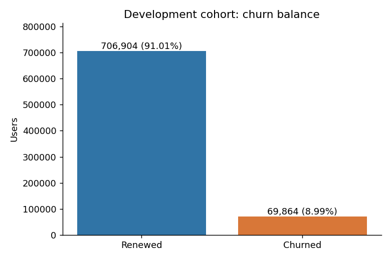
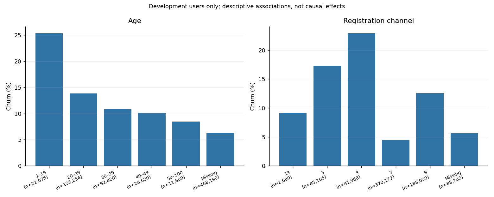
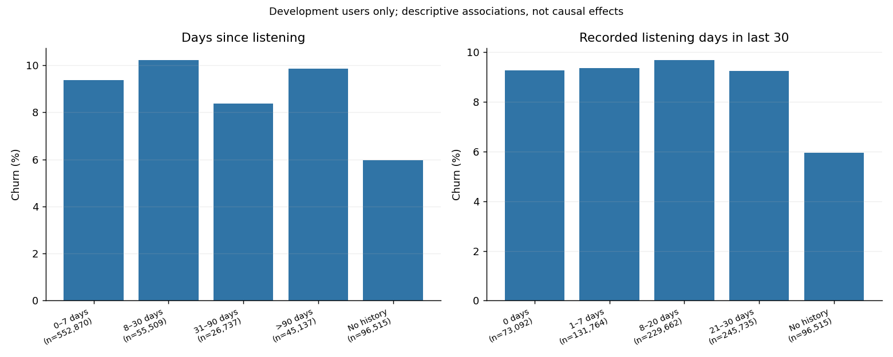
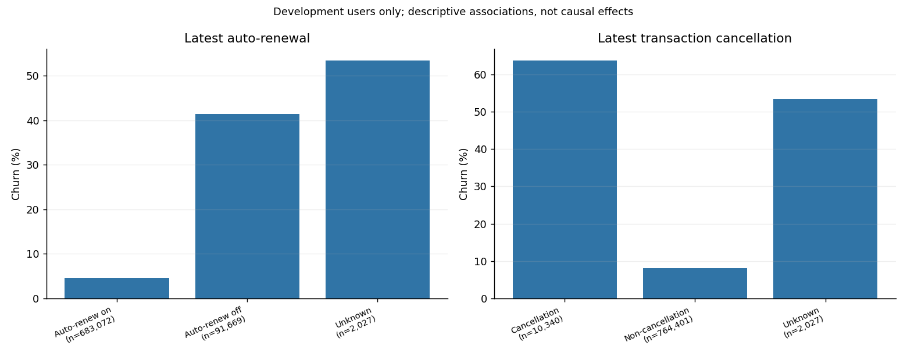
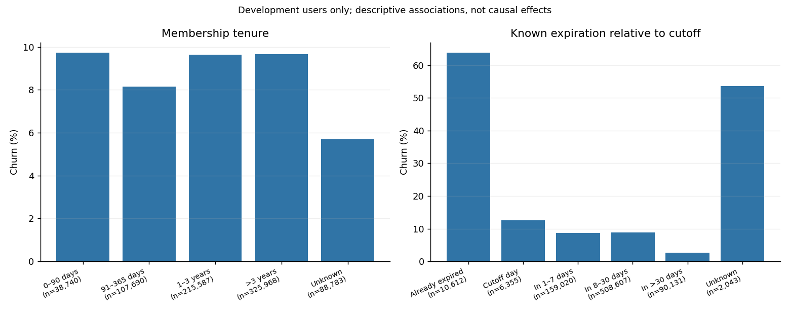
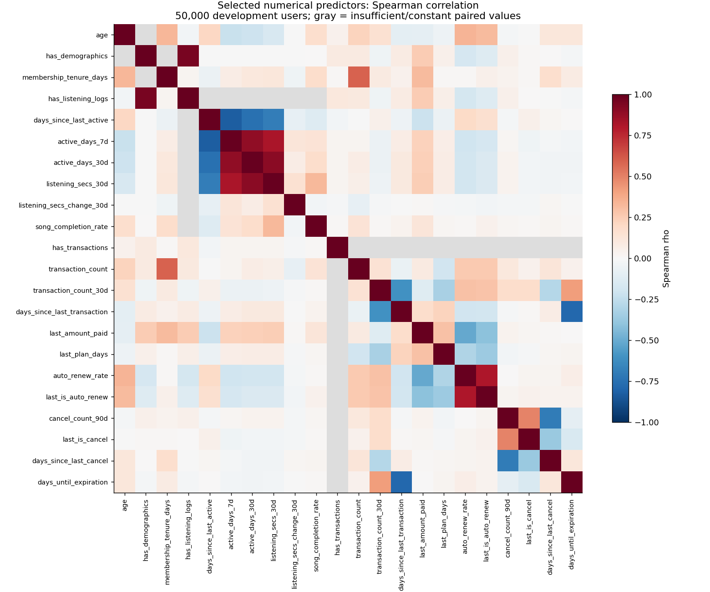

# KKBox v2: development EDA and compact feature set

Source: `data/processed/kkbox_v2_asof_20170228.parquet`; 970,960 rows, 970,960 unique IDs, 52 columns.
Source values are unchanged. Metadata version 1.0.1 records original
transactions/listening sources and inclusive cutoff 2017-02-28.

## Evaluation boundary

Sorted user IDs; NumPy `default_rng(42)` independently permutes each target class;
20% of each class is held out. Development: **776,768**; test: **194,192**.
Only IDs/labels were read to establish the split. All quality statistics, plots,
correlations, and feature decisions below use development data only. The saved
`reports/kkbox_v2_eda/test_user_ids.csv` fixes the final test boundary. Do not tune
features, imputers, thresholds, or models against this held-out set. This is a
within-cohort split, not a future-month deployment test. No models have been trained.

## Main comparisons

Churn rate: **8.994%**.
Medians omit missing measurements; status percentages use nonmissing flags.

- Auto-renew off: **41.5%** churn versus
  **4.5%** with auto-renew on. Latest cancellation:
  **63.7%** versus **8.1%**
  on non-cancellation records. These are much clearer descriptive differences than listening volume.
- Both outcome groups have a median **15 recorded listening days** in the last 30.
  Churners do not simply listen less in this snapshot. Retain a small behavioral set
  for later incremental evaluation, rather than claiming these are proven predictors.
- Historical seconds reach approximately **9.22e15**, and historical average seconds
  per day approximately **4.25e13**. There are **60**
  development users above 24 hours per recorded day. Omit the historical average and
  raw historical seconds from the initial predictors; these values need a raw-log audit.
- **58** users also exceed that bound in recent listening.
  This can include overlapping/device activity, so it is a diagnostic rather than an
  automatic deletion rule. Investigate or use training-only robust treatment later.
- Age/gender are about 60% missing. Male/female observed churn rates are nearly
  identical; leave gender optional. Missing demographic groups have different rates,
  so absence must not be encoded as a real age or location.

| is_churn | users | listening_recency | active_days_30d | listening_hours_30d | transactions | last_payment | latest_auto_renew_pct | latest_cancel_pct | days_until_expiration |
| --- | --- | --- | --- | --- | --- | --- | --- | --- | --- |
| 0 | 706904 | 0 | 15 | 17.8 | 17 | 149 | 92.4 | 0.532 | 17 |
| 1 | 69864 | 0 | 15 | 18.5 | 9 | 149 | 44.7 | 9.58 | 14 |

| analysis | segment | users | churn_pct |
| --- | --- | --- | --- |
| Age | 1–19 | 22075 | 25.4 |
| Age | 20–29 | 153254 | 13.9 |
| Age | 30–39 | 92820 | 10.8 |
| Age | 40–49 | 28620 | 10.2 |
| Age | 50–100 | 11809 | 8.46 |
| Age | Missing | 468190 | 6.22 |
| Registration channel | 13 | 2690 | 9.14 |
| Registration channel | 3 | 85105 | 17.3 |
| Registration channel | 4 | 41968 | 22.9 |
| Registration channel | 7 | 370172 | 4.49 |
| Registration channel | 9 | 188050 | 12.5 |
| Registration channel | Missing | 88783 | 5.7 |
| Days since listening | 0–7 days | 552870 | 9.36 |
| Days since listening | 8–30 days | 55509 | 10.2 |
| Days since listening | 31–90 days | 26737 | 8.37 |
| Days since listening | >90 days | 45137 | 9.85 |
| Days since listening | No history | 96515 | 5.96 |
| Recorded listening days in last 30 | 0 days | 73092 | 9.28 |
| Recorded listening days in last 30 | 1–7 days | 131764 | 9.37 |
| Recorded listening days in last 30 | 8–20 days | 229662 | 9.69 |
| Recorded listening days in last 30 | 21–30 days | 245735 | 9.25 |
| Recorded listening days in last 30 | No history | 96515 | 5.96 |
| Latest auto-renewal | Auto-renew on | 683072 | 4.51 |
| Latest auto-renewal | Auto-renew off | 91669 | 41.5 |
| Latest auto-renewal | Unknown | 2027 | 53.4 |
| Latest transaction cancellation | Cancellation | 10340 | 63.7 |
| Latest transaction cancellation | Non-cancellation | 764401 | 8.14 |
| Latest transaction cancellation | Unknown | 2027 | 53.4 |
| Membership tenure | 0–90 days | 38740 | 9.73 |
| Membership tenure | 91–365 days | 107690 | 8.15 |
| Membership tenure | 1–3 years | 215587 | 9.64 |
| Membership tenure | >3 years | 325968 | 9.65 |
| Membership tenure | Unknown | 88783 | 5.7 |
| Known expiration relative to cutoff | Already expired | 10612 | 63.8 |
| Known expiration relative to cutoff | Cutoff day | 6355 | 12.5 |
| Known expiration relative to cutoff | In 1–7 days | 159020 | 8.62 |
| Known expiration relative to cutoff | In 8–30 days | 508607 | 8.87 |
| Known expiration relative to cutoff | In >30 days | 90131 | 2.62 |
| Known expiration relative to cutoff | Unknown | 2043 | 53.5 |

Category detail (city: largest 8 groups; gender: all groups):

| attribute | value | users | churn_pct |
| --- | --- | --- | --- |
| city | 1 | 353759 | 6.34 |
| city | Missing | 88783 | 5.7 |
| city | 13 | 77657 | 12.2 |
| city | 5 | 56472 | 13.2 |
| city | 4 | 37749 | 12.8 |
| city | 15 | 34495 | 12.8 |
| city | 22 | 33497 | 12.6 |
| city | 6 | 20861 | 12.8 |
| gender | Missing | 466156 | 6.37 |
| gender | male | 163460 | 12.9 |
| gender | female | 147152 | 12.9 |

These are descriptive associations. Missing-history segments are separate from
observed zero activity; rare groups have less reliable rates. Differences in
exposure/history and subscription policies can confound these relationships.

## Data quality and potential leakage

Duplicate IDs in source: **0**. Nonfinite numerical values in development:
**0** (count across fields).

| Check | Development users |
| --- | --- |
| Negative nonnegative-valued fields (row count, possibly overlapping) | 0 |
| Age outside 1–100 | 0 |
| Rate outside 0–1 | 0 |
| Post-cutoff recorded behavior/registration | 0 |
| Listening recency disagrees with date | 0 |
| Transaction recency disagrees with date | 0 |
| Inconsistent listening windows | 0 |
| Inconsistent transaction windows | 0 |
| No-log indicator with nonmissing measurements | 0 |
| No-transaction indicator with nonmissing count | 0 |
| Masked demographics with nonmissing attributes | 0 |
| Users with invalid listening rows | 12651 |
| Users with invalid transaction rows | 0 |
| Raw completion ratio unavailable/unsafe despite logs | 12651 |
| Historical average listening above 24 hours per recorded day | 60 |
| Recent listening above 24 hours per recorded day | 58 |
| Likely epoch-date expiration sentinel (masked in derived feature) | 16 |
| Invalid binary has_demographics | 0 |
| Invalid binary has_listening_logs | 0 |
| Invalid binary has_transactions | 0 |
| Invalid binary age_missing | 0 |
| Invalid binary gender_missing | 0 |
| Invalid binary last_is_auto_renew | 0 |
| Invalid binary last_is_cancel | 0 |
| Invalid binary ever_cancel | 0 |

Dates were filtered upstream before aggregation. The development date checks and
source metadata are consistent with this rule; this analysis does not rescan raw
behavioral events. Expiration is a planned future date recorded in an eligible past
transaction, so an expiry after cutoff is not itself future-event leakage. Keep signed
`days_until_expiration` provisionally, with the documented latest-state ordering
assumption. The **16** development expiry values equal to
1970-01-01 are treated as a likely placeholder and masked in the derived feature;
this is an explicit quality assumption, not proof of the original encoding. Other
negative expiration offsets remain valid. Strong association is expected for a subscription-gap target;
later modeling should compare performance with and without it. Supplied labels have
not been independently regenerated, and their exact horizon is not certified.
Demographics are a later unversioned snapshot; masking future registrations does
not establish historical availability of every attribute. Consider a no-demographics
sensitivity comparison later.

Negative listening changes and negative days until expiration are legitimate.
The table below shows outlier ranges; do not interpret an extreme as automatically
invalid. No rows are dropped or winsorized. For skewed counts/seconds/payment amounts,
consider log1p or training-fold-only clipping during modeling. Never learn clipping
or imputation thresholds from the final test set. Invalid-row counts are audit
attributes, and sums from partially invalid histories may understate real activity.

## Three derived features

- `membership_tenure_days`: cutoff minus usable registration date; NULL if unavailable.
- `song_completion_rate`: `total_songs_100 / total_songs`; NULL for zero/missing
  denominator, inconsistent numerator, or any flagged invalid listening history.
  This conservative guard avoids ratios of partial totals. `num_100` means over
  98.5% completion, not necessarily a literal 100% play.
- `days_until_expiration`: latest recorded expiry minus cutoff; retain negative
  values for expired subscriptions and NULL for unavailable/1970-01-01 expiry.

These are calculated in a development SQL view, not written into the source parquet.

## Recommended predictors: 24

`city, age, registered_via, has_demographics, membership_tenure_days, has_listening_logs, days_since_last_active, active_days_7d, active_days_30d, listening_secs_30d, listening_secs_change_30d, song_completion_rate, has_transactions, transaction_count, transaction_count_30d, days_since_last_transaction, last_amount_paid, last_plan_days, auto_renew_rate, last_is_auto_renew, cancel_count_90d, last_is_cancel, days_since_last_cancel, days_until_expiration`

This is a compact initial specification, not a model-performance claim. Categories
are city and registered_via. Keep NULL semantics until a training-only
modeling pipeline chooses imputation/encoding. Explicit history indicators distinguish
missing sources from observed zero activity. Age/gender missing flags are omitted
because missingness can be encoded with the underlying fields later. Different
time windows and latest/historical auto-renewal are intentionally retained initially.

Selected features with the most missing values:

| Column | Missing % |
| --- | --- |
| days_since_last_cancel | 79.4 |
| age | 60.3 |
| song_completion_rate | 14.1 |
| days_since_last_active | 12.4 |
| active_days_7d | 12.4 |
| active_days_30d | 12.4 |
| listening_secs_30d | 12.4 |
| listening_secs_change_30d | 12.4 |

All original attributes are classified below. Transform means replace/use to derive
the stated selected feature, rather than retain another raw predictor. Optional
attributes are excluded from this initial 24-predictor specification.

| Original column | Decision | Reason |
| --- | --- | --- |
| msno | Remove | Identifier and split/join key; never a predictor. |
| is_churn | Remove | Target, retained separately from predictors. |
| city | Keep | Location category; do not interpret numeric codes as ordered. |
| age | Keep | Interpretable demographic; retain NULL rather than invent an age. |
| gender | Optional | About 60% missing; observed male/female churn rates nearly identical in development. |
| registered_via | Keep | Acquisition channel category, not an ordered number. |
| registration_date | Transform | Replace raw date with membership_tenure_days. |
| has_demographics | Keep | Distinguishes usable demographics from absent/masked records. |
| age_missing | Remove | Exactly derivable from age NULL status. |
| gender_missing | Remove | Exactly derivable from gender NULL status. |
| has_listening_logs | Keep | Distinguishes missing history from observed zero activity. |
| listening_record_count | Remove | Row-count audit; use active dates for engagement. |
| invalid_listening_rows | Remove | Quality audit, not customer behavior; used to guard completion ratio. |
| active_days | Optional | Historical exposure; recent activity is easier to compare across users. |
| total_songs | Transform | Use as completion-rate denominator; omit raw historical volume. |
| total_songs_100 | Transform | Use as completion-rate numerator; omit raw historical volume. |
| total_unique_songs_daily | Remove | Repeated daily counts, not distinct lifetime songs; another volume measure. |
| total_listening_secs | Optional | Historical volume/exposure; overlaps recent and average listening. |
| avg_secs_per_active_day | Optional | Implausible positive outliers contaminate historical intensity; omit until audited. |
| last_active_date | Remove | Exactly represented by days_since_last_active at fixed cutoff. |
| days_since_last_active | Keep | Interpretable inactivity/recency. |
| active_days_7d | Keep | Very recent activity; preserve alongside the longer window initially. |
| active_days_30d | Keep | Recent frequency distinct from listening intensity. |
| listening_secs_7d | Optional | Short-window volume; overlaps 30-day volume and 7-day frequency. |
| listening_secs_30d | Keep | Recent listening volume; skew/outliers require attention later. |
| listening_secs_previous_30d | Remove | Exactly recoverable from recent volume minus its change. |
| songs_30d | Optional | Alternative recent-volume measure to seconds. |
| listening_secs_change_30d | Keep | Absolute change between equal 30-day windows; negative is meaningful. |
| listening_secs_ratio_30d | Remove | Redundant with recent volume/change; undefined at zero prior activity. |
| has_transactions | Keep | Distinguishes no records from observed no recent transactions. |
| transaction_count | Keep | Observed history depth; counts events, not successful purchases. |
| transaction_count_30d | Keep | Recent transaction frequency. |
| transaction_count_90d | Optional | Intermediate window overlaps history and recent frequency. |
| invalid_transaction_rows | Remove | Data-quality audit; investigate invalid fields rather than modeling the count. |
| last_transaction_date | Remove | Exactly represented by days_since_last_transaction. |
| days_since_last_transaction | Keep | Payment/subscription interaction recency. |
| total_amount_paid | Remove | History-length driven and largely represented by frequency/payment size. |
| avg_amount_paid | Optional | Historical payment level; latest amount better reflects current plan. |
| last_amount_paid | Keep | Latest known payment, including legitimate zero-cost plans. |
| avg_plan_days | Optional | Historical duration; latest duration reflects current subscription. |
| last_plan_days | Keep | Current recorded plan duration. |
| last_membership_expire_date | Transform | Use signed days_until_expiration, masking the likely 1970-01-01 sentinel. |
| auto_renew_rate | Keep | Historical renewal preference. |
| last_is_auto_renew | Keep | Latest status may differ from historical preference. |
| ever_cancel | Remove | Derivable from observed cancel_count when flags are valid. |
| cancel_count | Optional | Historical cancellations; prefer recent 90-day count for comparability. |
| cancel_ratio | Optional | History-normalized cancellations; not equivalent to actual churn. |
| last_is_cancel | Keep | Latest recorded cancellation state; not the target itself. |
| days_since_last_cancel | Keep | Cancellation recency; NULL means no known cancellation or no history. |
| cancel_count_30d | Optional | Shorter version of retained 90-day cancellation count. |
| cancel_count_90d | Keep | Recent cancellation frequency. |
| transactions_since_last_cancel | Optional | Recovery signal overlaps cancellation/transaction recency. |

Strongest numerical redundancies (absolute Spearman rho >= .85, at least 500
pairwise nonmissing observations in a sample of up to 50,000 development users):

| Feature A | Feature B | Spearman rho | Pairwise n |
| --- | --- | --- | --- |
| listening_record_count | active_days | 1 | 43802 |
| total_songs_100 | total_listening_secs | 0.997 | 43802 |
| ever_cancel | cancel_count | 0.996 | 49865 |
| cancel_count | cancel_ratio | 0.993 | 49865 |
| ever_cancel | cancel_ratio | 0.991 | 49865 |
| total_songs | total_listening_secs | 0.991 | 43802 |
| listening_secs_30d | songs_30d | 0.986 | 43802 |
| total_songs | total_songs_100 | 0.986 | 43802 |
| total_songs | total_unique_songs_daily | 0.986 | 43802 |
| total_unique_songs_daily | total_listening_secs | 0.975 | 43802 |
| total_songs_100 | total_unique_songs_daily | 0.969 | 43802 |
| age_missing | gender_missing | 0.956 | 50000 |

Correlation alone is not a removal rule. Exact structural redundancy, meaning,
missingness, and the compact specification drive the decisions. Sample pair counts
matter especially for rare cancellations. No target-based importance model was fit.

## Figures

## Column audit (development only)

Approximate median/P99; exact min/max. Target excluded from numerical summaries.

| Column | Type | Missing % | Min | Mean | Median | P99 | Max |
| --- | --- | --- | --- | --- | --- | --- | --- |
| msno | VARCHAR | 0 | — | — | — | — | — |
| is_churn | INTEGER | 0 | — | — | — | — | — |
| city | VARCHAR | 11.4 | — | — | — | — | — |
| age | INTEGER | 60.3 | 1 | 29.9 | 28 | 57 | 100 |
| gender | VARCHAR | 60 | — | — | — | — | — |
| registered_via | VARCHAR | 11.4 | — | — | — | — | — |
| registration_date | DATE | 11.4 | 2004-03-26 | — | — | — | 2017-02-28 |
| has_demographics | INTEGER | 0 | 0 | 0.886 | 1 | 1 | 1 |
| age_missing | INTEGER | 0 | 0 | 0.603 | 1 | 1 | 1 |
| gender_missing | INTEGER | 0 | 0 | 0.6 | 1 | 1 | 1 |
| has_listening_logs | INTEGER | 0 | 0 | 0.876 | 1 | 1 | 1 |
| listening_record_count | BIGINT | 12.4 | 1 | 279 | 229 | 765 | 790 |
| invalid_listening_rows | BIGINT | 12.4 | 0 | 0.0391 | 0 | 1 | 68 |
| active_days | BIGINT | 12.4 | 1 | 279 | 229 | 765 | 790 |
| total_songs | DOUBLE | 12.4 | 1 | 1.15e+04 | 6.39e+03 | 7e+04 | 1.02e+06 |
| total_songs_100 | DOUBLE | 12.4 | 0 | 8.58e+03 | 4.38e+03 | 6.08e+04 | 4.45e+05 |
| total_unique_songs_daily | DOUBLE | 12.4 | 1 | 8.43e+03 | 4.75e+03 | 5.02e+04 | 2.35e+05 |
| total_listening_secs | DOUBLE | 12.4 | 0.078 | 2.71e+11 | 1.2e+06 | 1.54e+07 | 9.22e+15 |
| avg_secs_per_active_day | DOUBLE | 12.4 | 0.078 | 6.21e+08 | 5.26e+03 | 2.88e+04 | 4.25e+13 |
| last_active_date | DATE | 12.4 | 2015-01-01 | — | — | — | 2017-02-28 |
| days_since_last_active | BIGINT | 12.4 | 0 | 24.1 | 0 | 494 | 789 |
| active_days_7d | BIGINT | 12.4 | 0 | 3.59 | 4 | 7 | 7 |
| active_days_30d | BIGINT | 12.4 | 0 | 14.9 | 15 | 30 | 30 |
| listening_secs_7d | DOUBLE | 12.4 | 0 | 2.84e+04 | 1.41e+04 | 2.15e+05 | 2.85e+06 |
| listening_secs_30d | DOUBLE | 12.4 | 0 | 1.17e+05 | 6.43e+04 | 8.33e+05 | 1.07e+07 |
| listening_secs_previous_30d | DOUBLE | 12.4 | 0 | 1.18e+05 | 6.57e+04 | 8.29e+05 | 7.31e+06 |
| songs_30d | DOUBLE | 12.4 | 0 | 591 | 348 | 3.75e+03 | 4.43e+04 |
| listening_secs_change_30d | DOUBLE | 12.4 | -5.27e+06 | -1.88e+03 | -0.0407 | 2.82e+05 | 3.58e+06 |
| listening_secs_ratio_30d | DOUBLE | 24.7 | 0 | 18 | 0.907 | 20.5 | 5.92e+06 |
| has_transactions | INTEGER | 0 | 0 | 0.997 | 1 | 1 | 1 |
| transaction_count | BIGINT | 0.261 | 1 | 15.6 | 16 | 30 | 63 |
| transaction_count_30d | BIGINT | 0.261 | 0 | 1.09 | 1 | 2 | 6 |
| transaction_count_90d | BIGINT | 0.261 | 0 | 2.72 | 3 | 5 | 12 |
| invalid_transaction_rows | BIGINT | 0.261 | 0 | 0 | 0 | 0 | 0 |
| last_transaction_date | DATE | 0.261 | 2015-01-05 | — | — | — | 2017-02-28 |
| days_since_last_transaction | BIGINT | 0.261 | 0 | 20.5 | 14 | 356 | 785 |
| total_amount_paid | DOUBLE | 0.261 | 0 | 2.14e+03 | 1.9e+03 | 4.26e+03 | 8.14e+03 |
| avg_amount_paid | DOUBLE | 0.261 | 0 | 150 | 141 | 872 | 2e+03 |
| last_amount_paid | DOUBLE | 0.261 | 0 | 152 | 149 | 974 | 2e+03 |
| avg_plan_days | DOUBLE | 0.261 | 0 | 34.1 | 30 | 196 | 450 |
| last_plan_days | INTEGER | 0.261 | 0 | 35.2 | 30 | 257 | 450 |
| last_membership_expire_date | DATE | 0.261 | 1970-01-01 | — | — | — | 2017-03-31 |
| auto_renew_rate | DOUBLE | 0.261 | 0 | 0.87 | 1 | 1 | 1 |
| last_is_auto_renew | INTEGER | 0.261 | 0 | 0.882 | 1 | 1 | 1 |
| ever_cancel | INTEGER | 0.261 | 0 | 0.207 | 0 | 1 | 1 |
| cancel_count | BIGINT | 0.261 | 0 | 0.256 | 0 | 2 | 20 |
| cancel_ratio | DOUBLE | 0.261 | 0 | 0.0141 | 0 | 0.166 | 1 |
| last_is_cancel | INTEGER | 0.261 | 0 | 0.0133 | 0 | 1 | 1 |
| days_since_last_cancel | BIGINT | 79.4 | 0 | 319 | 313 | 770 | 789 |
| cancel_count_30d | BIGINT | 0.261 | 0 | 0.019 | 0 | 1 | 3 |
| cancel_count_90d | BIGINT | 0.261 | 0 | 0.042 | 0 | 1 | 6 |
| transactions_since_last_cancel | BIGINT | 79.4 | 0 | 8.73 | 8 | 24 | 46 |
| membership_tenure_days | derived | 11.4 | 0 | 1.26e+03 | 1e+03 | 4.43e+03 | 4722 |
| song_completion_rate | derived | 14.1 | 0 | 0.676 | 0.714 | 0.971 | 1 |
| days_until_expiration | derived | 0.263 | -1156 | 15.2 | 16 | 31 | 31 |
